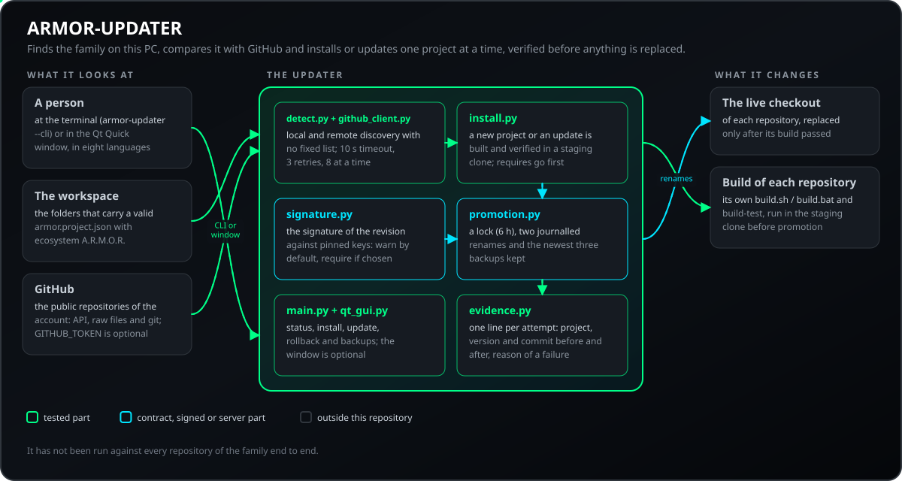
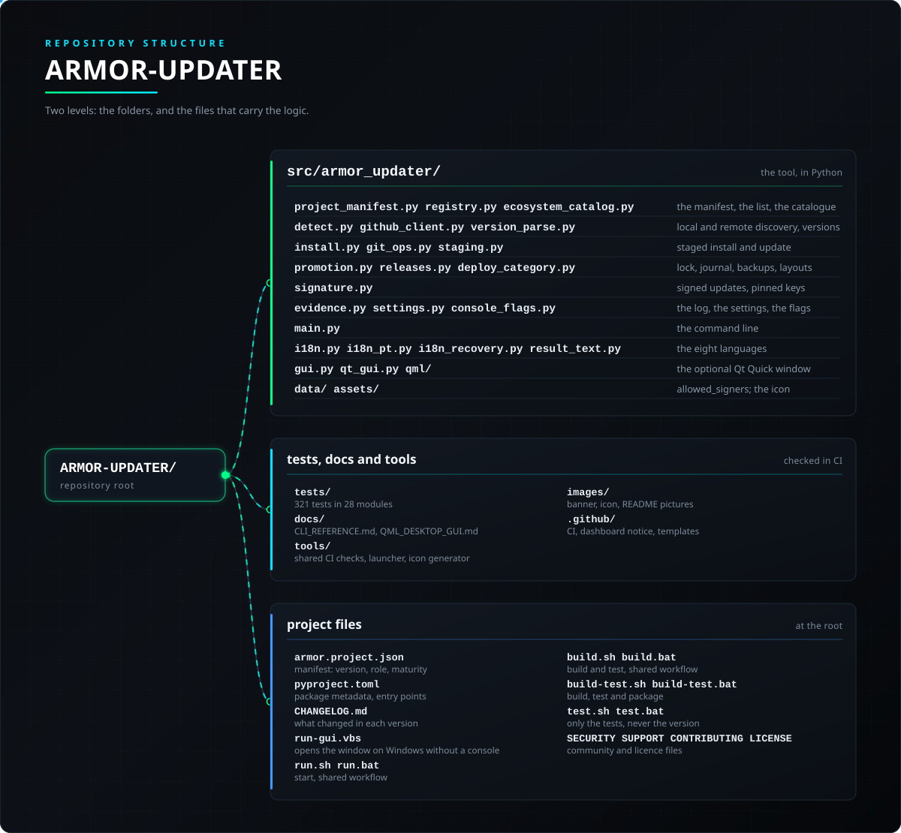

<p align="center">
  
</p>

# 🛠️ ARMOR-UPDATER

<p align="center">
  <a href="README.md">🇺🇸 English</a> |
  <a href="README_spa.md">🇪🇸 Español</a> |
  <a href="README_fra.md">🇫🇷 Français</a> |
  <a href="README_ita.md">🇮🇹 Italiano</a> |
  🇩🇪 <b>Deutsch</b> |
  <a href="README_zho.md">🇨🇳 简体中文</a> |
  <a href="README_jpn.md">🇯🇵 日本語</a> |
  <a href="README_por.md">🇵🇹 Português</a>
</p>

### Erkennt, installiert und aktualisiert jedes A.R.M.O.R.-Repository auf dem Rechner, auf dem es läuft (ein Python-Programm ohne Pflichtabhängigkeiten)

<p align="center">
  
  
  
  
  
  
  
</p>

---

**Ehrlichkeitsprüfung - was heute läuft:** Die Manifest-Erkennung, der Versionsvergleich, die Signaturprüfung, die gestufte Installation und Aktualisierung mit Sperre, Journal, Sicherungen und Rückkehr, das Nachweisprotokoll und die Oberflächentabellen in acht Sprachen sind getestet (288 Tests), und die Qt-Quick-Oberfläche lief unter Windows. Sie wurde nicht gegen jedes Repository der Familie von Anfang bis Ende ausgeführt, und die Installationen brauchen `git` und die Build-Werkzeuge jedes Repositorys auf dem Rechner.

---

## 📋 Auf einen Blick

| | |
|---|---|
| Version | `0.1.5` |
| Reifegrad | Etabliert |
| Rolle | Desktop-Werkzeug, das die Familie auf einem PC installiert und aktualisiert, ein Projekt nach dem anderen |
| Technik | Python 3.10+, git; optional PySide6 (Qt Quick) |
| Tests | 288 (`python -m pytest tests -q`, etwa sechs Minuten) |
| Schnittstellen | `armor-updater --cli` mit `status`, `install`, `update`, `rollback` und `backups` sowie ein Qt-Quick-Fenster in acht Sprachen |
| Läuft auf | Ein PC mit Python und git (das Fenster lief nur unter Windows) |
| Auf echter Hardware | Nicht zutreffend: es ist ein Desktop-Programm; seine Qt-Quick-Oberfläche wurde unter Windows ausgeführt |
| Lizenz | GPL-3.0-or-later |

**Springe zu:** [Überblick](#-überblick) · [Architektur](#-architektur) · [Sicherheit](#-sicherheit-und-schutz) · [Schnittstellen](#-schnittstellen) · [Konfiguration](#-konfiguration) · [Schnellstart](#-schnellstart) · [Tests](#-tests) · [Probleme](#-fehlerbehebung) · [Struktur](#-struktur-des-repositorys) · [Verwandte](#-verwandte-projekte)

## 🚦 Projektstatus

Jede Zeile ist ein Teil dieses Repositorys, und die Ampel sagt, wie weit er heute ist. Sie beruht auf dem, was das Repository zeigen kann (Tests, Builds, Läufe), nicht auf dem, was geplant ist.

🟢 Fertig und überprüft · 🟡 Funktioniert, mit bekannten Grenzen · 🟠 Teilweise fertig oder noch nicht überprüft · 🔴 Nicht gemacht oder funktioniert nicht

| Bereich | Stand | Was das hier bedeutet |
|---|---|---|
| Software | 🟡 | Die Manifest-Erkennung, der Versionsvergleich und die gestufte Installation und Aktualisierung funktionieren; sie wurden nicht durchgängig gegen jedes Repository der Familie ausgeführt. |
| Tests | 🟢 | 288 Tests bestehen (`python -m pytest tests -q`): die Erkennung, der Versionsvergleich, die Signaturprüfung, die gestufte Installation mit Sperre, Journal, Sicherungen und Rückfall, das Beweisprotokoll und die Tabellen der acht Sprachen. |
| Oberfläche | 🟡 | Die Qt-Quick-Oberfläche lief nur unter Windows. |
| Sicherheit | 🟡 | Die Signaturprüfung und das Beweisprotokoll sind auf dem Host getestet; es gab keine unabhängige Prüfung. |
| Aktualisierungen | 🟡 | Die Installationen, die er vornimmt, brauchen `git` und die eigenen Build-Werkzeuge jedes Repositorys auf dem Rechner. |
| Dokumentation | 🟢 | Acht Sprachen und das Änderungsprotokoll sind aktuell. |

## 🎯 Überblick

* **Erkennung ohne feste Liste:** Ein lokaler Ordner gehört dazu, sobald er ein gültiges `armor.project.json` mit `ecosystem: "A.R.M.O.R."` trägt; entfernt wird jedes öffentliche Repository des Kontos genauso geprüft. Ein `GITHUB_TOKEN` ist optional: Er hebt nur GitHubs Grenze von 60 Anfragen pro Stunde an.
* **Installieren und aktualisieren, nie an Ort und Stelle:** Ein neues Projekt und eine Aktualisierung werden zuerst in einem unabhängigen Staging-Klon gebaut und geprüft und erst danach übernommen - zwei protokollierte Umbenennungen, die ersetzte Kopie unter `.armor-updater/backups/` aufbewahrt (die drei neuesten) -, wenn der Build gelingt; eine Aktualisierung auf den schon installierten Commit tut nichts; eine echte nicht eingecheckte lokale Änderung wird glatt abgelehnt, nie stillschweigend verworfen; ein Absturz zwischen den Umbenennungen wird beim nächsten Lauf geheilt, und `rollback` stellt die neueste Kopie wieder her.
* **Eines nach dem anderen, und der Reihe nach:** Eine Sperre verhindert, dass zwei Updater gleichzeitig an einem Arbeitsbereich arbeiten; ein Stapel beginnt mit ARMOR-COMMON (jeder Build braucht es), und ein Projekt wird ohne es nicht gebaut.
* **Nachweis:** jeder Versuch, erfolgreich oder nicht, fügt einer lokalen Protokolldatei eine Zeile mit Projekt, Version und Commit davor und danach sowie dem Grund eines Fehlschlags hinzu.
* **Voraussetzungen:** Ein Manifest kann im optionalen Feld `requires` die Projekte nennen, die zuerst installiert sein müssen; eine Sammelaktion stellt sie voran, und eine Installation oder Aktualisierung wird mit einer klaren Meldung in der Sprache des Fensters abgelehnt, wenn eines davon fehlt.
* **Signaturen, standardmäßig warnen:** Eine Revision ohne gültige Signatur wird trotzdem installiert oder aktualisiert, und das Fenster wie die Befehlszeile weisen darauf hin, dass sie nicht signiert ist; wer in den Einstellungen *verlangen* wählt (`"signature_policy": "require"`), lehnt sie stattdessen ab.
* **Frühere Kopien:** Das Fenster kann die frühere Kopie eines Projekts wiederherstellen oder die aufbewahrten Kopien löschen, und `status` zeigt, wie viele es sind und wie viel Speicherplatz sie belegen.
* **Eine CLI und eine optionale Desktop-Oberfläche:** `armor-updater status`/`install`/`update`, sowie eine Qt-Quick-Oberfläche (`pip install ".[gui]"`) in den acht Sprachen des Ökosystems.

## 🧩 Rolle in A.R.M.O.R.

ARMOR-UPDATER ist das Desktop-Werkzeug für alle, die eine Kopie der Familie auf einem PC halten: Es findet die A.R.M.O.R.-Repositorys der Maschine, vergleicht sie mit GitHub und installiert oder aktualisiert eines nach dem anderen und prüft, bevor es etwas ersetzt. Es ist getrennt von den Updates, die [ARMOR-STUDIO](https://github.com/JuanenRac/ARMOR-STUDIO) auf dem CM5 steuert (die laufen über [ARMOR-DEVOPS](https://github.com/JuanenRac/ARMOR-DEVOPS)): dieses ist für die Maschine eines Entwicklers.

| Er spricht mit | Wie | Wozu |
|---|---|---|
| Lokaler Arbeitsordner | Ordner mit gültiger `armor.project.json` | was installiert ist und in welcher Version |
| GitHub | `api.github.com`, `raw.githubusercontent.com` und git; `GITHUB_TOKEN` optional | die neueste Version jedes Repositorys des Kontos |
| ARMOR-COMMON | ein Projekt kann es in `requires` aufführen | es kommt in jedem Stapel zuerst: jeder Build braucht es |
| ARMOR-DEVOPS | getrennt | die Updates, die ARMOR-STUDIO auf dem CM5 steuert, laufen darüber, nicht über dieses Werkzeug |

## 🏛️ Architektur

<p align="center">
  
</p>

## 🔒 Sicherheit und Schutz

| Bedrohung | Abwehr |
|---|---|
| Kompromittierter Code wird installiert | Die Commits werden gegen Signierer in `data/allowed_signers` (OpenSSH-Format) geprüft, deren Fingerabdruck in `signature.py` fixiert ist; ändert man die Datei ohne den Pin, scheitert jede Prüfung (geschlossen); `signature_policy` ist `warn` (Standard: installiert und sagt, dass nicht signiert ist) oder `require` (lehnt ab) |
| Eine halbe Installation oder ein Ersatz an Ort und Stelle | Nie an Ort und Stelle: alles wird in einem unabhängigen Staging-Klon gebaut und geprüft und mit zwei journalisierten Umbenennungen übernommen (`promotion.json`); der ersetzte Checkout bleibt in `.armor-updater/backups/` (die neuesten drei) |
| Zwei Updater auf einem Arbeitsordner | Eine Sperre (`.armor-updater/lock`), die nach 6 Stunden verfällt |
| Eine nicht gebaute Abhängigkeit | ARMOR-COMMON kommt zuerst und ein Projekt wird ohne es nicht gebaut; das optionale Feld `requires` des Manifests ordnet einen Stapel und lehnt eine Installation mit klarer Meldung in der Sprache des Fensters ab |
| Verlorene lokale Änderungen | Ein Update auf den bereits installierten Commit tut nichts; eine wirklich nicht committete lokale Änderung wird glatt abgelehnt |
| Eine gefälschte Entdeckung | Ein Projekt zählt nur mit gültiger `armor.project.json`, die `ecosystem: "A.R.M.O.R."` erklärt; entfernt wird jedes öffentliche Repository des Kontos genauso geprüft |
| GitHub langsam oder nicht erreichbar | Zeitlimit 10 s, bis zu 8 gleichzeitig, 3 Wiederholungen (Basiswartezeit 0,5 s), `ls-remote` 20 s; die Verzögerung von Minuten bei `raw.githubusercontent.com` ist eingeplant |

Jeder Versuch, ob erfolgreich oder nicht, hängt eine Zeile an das lokale Nachweisprotokoll an (Projekt, Version und Commit vorher und nachher, Fehlergrund). Die Installationen brauchen `git` und die Build-Werkzeuge jedes Repositorys; die Signatur wird nur gemeldet, außer man wählt `require`; es lief nicht gegen jedes Repository der Familie von Anfang bis Ende, und eine unabhängige Prüfung gab es nicht.

## 🔌 Schnittstellen

| Route | Authentifizierung | Was sie tut |
|---|---|---|
| `armor-updater --cli status` | - | was installiert ist, seine Version und die neueste auf GitHub; `--workspace D`, `--offline` (nur lokal), `--notes` (die echten Notizen jedes Projekts), `--json` (maschinenlesbar) |
| `armor-updater --cli install <project>` | - | EIN noch nicht installiertes Projekt klonen, bauen und installieren; `--no-build` klont nur |
| `armor-updater --cli update <project>` | - | ein installiertes aktualisieren, vor dem Einsetzen gebaut und geprüft; `--no-build` holt nur |
| `armor-updater --cli rollback <project>` | - | die neueste Sicherung des ersetzten Checkouts zurückspielen |
| `armor-updater --cli backups [<project>]` | - | die Sicherungen ersetzter Checkouts und ihren Plattenbedarf auflisten; `--prune N` behält die neuesten N je Projekt |
| `armor-updater --version` | - | die Version des Werkzeugs |

Das Fenster (Qt Quick, `pip install ".[gui]"`, unter Windows von `run-gui.vbs` gestartet) zeigt denselben Zustand, installiert und aktualisiert ein Projekt, stellt die vorige Kopie eines Projekts wieder her oder löscht die aufbewahrten Kopien und sagt, wenn eine Revision nicht signiert ist; es ist in acht Sprachen verfasst (`i18n.py`, `i18n_pt.py`, `i18n_recovery.py`, `result_text.py`) und lief nur unter Windows. Vollständige Referenz: [docs/CLI_REFERENCE.md](docs/CLI_REFERENCE.md) und [docs/QML_DESKTOP_GUI.md](docs/QML_DESKTOP_GUI.md).

## ⚙️ Konfiguration

| Einstellung | Standard | Was sie tut |
|---|---|---|
| `--workspace` | der übergeordnete Ordner des Werkzeugs | die zu durchsuchende Wurzel des Arbeitsordners |
| `GITHUB_TOKEN` | optional | hebt das GitHub-Limit von 60 Anfragen pro Stunde an; er wird nur gelesen, nie geschrieben |
| `signature_policy` | warn | `warn` installiert und sagt, dass nicht signiert ist; `require` lehnt ab; gespeichert in `~/.armor_updater_settings.json` |
| Gesicherte Kopien | 3 | die neuesten drei je Projekt; `backups --prune N` ändert es |
| Sperre | 6 h | eine ältere Sperre wird ignoriert |

`.env.example` zeigt die Variablen, die der Build eines Repositorys lesen kann. Die Sprache des Fensters folgt `~/.armor_updater_settings.json` (und der alten `~/.armor_updater_lang.json`).

## 🚀 Schnellstart

**Voraussetzungen:** Python 3.10+, `git` und die Build-Werkzeuge der Repositorys, die Sie installieren; optional: PySide6 für das Desktop-Fenster.

```bash
pip install -e ".[dev]"                     # oder ".[dev,gui]" für das optionale Qt-Quick-Fenster
python -m pytest tests -q                   # 288 Tests, etwa sechs Minuten
armor-updater --cli status                  # lokaler und GitHub-Zustand jedes Repositorys
armor-updater --cli install ARMOR-NETWORK   # ein noch nicht installiertes Repository klonen, bauen und installieren
armor-updater --cli update ARMOR-NETWORK    # ein installiertes aktualisieren (vor dem Einsetzen gebaut und geprüft)
armor-updater --cli rollback ARMOR-NETWORK  # die neueste Sicherung eines ersetzten Checkouts zurückspielen
```

Siehe [docs/CLI_REFERENCE.md](docs/CLI_REFERENCE.md).

## 🧪 Tests

```powershell
python -m pytest tests -q  # 288 Tests, etwa sechs Minuten
python -I tools/armor_ci_validate.py
```

| Bereich | Was er abdeckt |
|---|---|
| Entdeckung und Versionen | das Manifest, das Register, lokale und entfernte Erkennung, Versionsauswertung und der GitHub-Client |
| Installation und Aktualisierung | Staging, Sperre, Journal, Sicherungen und Rückgängigmachen, Voraussetzungen und das Nachweisprotokoll |
| Signaturen | die fixierten Schlüssel, das geschlossene Scheitern und die beiden Richtlinien |
| Kommandozeile | `status`, `install`, `update`, `rollback` und `backups` mit ihren Optionen |
| Sprachen und Fenster | die acht Sprachen (`test_i18n.py`) und die Texte jedes Ergebnisses |

`python -m unittest` findet nur drei davon: Die Suite ist für pytest geschrieben (`conftest.py` liegt in `tests/`) und braucht fast sechs Minuten. GitHub Actions führt bei jedem Push und Pull Request die A.R.M.O.R.-Basis aus: die Prüfung von Manifest, Version, Änderungsprotokoll und README-Parität, dann den eigenen Build und die eigenen Tests des Projekts.

## 🏗️ Build und Veröffentlichung

Es ist reines Python: Es gibt nichts zu kompilieren (`pip install -e .`). Die Version steht in `pyproject.toml`, in `armor.project.json` und im README-Badge (aus dem Manifest gelesen); jede Version hat ihren Eintrag in [CHANGELOG.md](CHANGELOG.md). Releases werden auf GitHub veröffentlicht.

## 🩺 Fehlerbehebung

| Du siehst | Weil | Tu |
|---|---|---|
| Ein Update sagt, es sei nichts passiert | das Projekt ist bereits auf dem Commit, den GitHub hat | nichts zu tun |
| Ein Update wird wegen lokaler Änderungen abgelehnt | der Checkout hat eine nicht committete Änderung | committen oder beiseitelegen, dann aktualisieren |
| Es meldet, eine Voraussetzung sei nicht installiert | das Manifest führt es in `requires` auf | dieses Projekt zuerst installieren (ein Stapel ordnet sie schon) |
| Fenster oder Kommandozeile sagen, die Revision sei nicht signiert | `signature_policy` ist `warn`, also installiert es und sagt es | in den Einstellungen `require` wählen, um unsignierte Revisionen abzulehnen |
| Ein Update hat etwas kaputt gemacht | die neue Revision baut, verhält sich aber falsch | `armor-updater --cli rollback <Projekt>` spielt die neueste Sicherung zurück |

## 📂 Struktur des Repositorys

<p align="center">
  
</p>

<details>
<summary>Textversion des Baums</summary>

```text
ARMOR-UPDATER/
├── src/armor_updater/
│   ├── project_manifest.py registry.py ecosystem_catalog.py   das Manifest, die Liste, der Katalog
│   ├── detect.py github_client.py version_parse.py            lokale und entfernte Suche, Versionen
│   ├── install.py git_ops.py staging.py                       gestufte Installation und Aktualisierung
│   ├── promotion.py releases.py deploy_category.py            Sperre, Journal, Sicherungen, Layouts
│   ├── signature.py                                           signierte Updates, fixierte Schlüssel
│   ├── evidence.py settings.py console_flags.py               das Protokoll, die Einstellungen, die Optionen
│   ├── main.py                                                die Kommandozeile
│   ├── i18n.py i18n_pt.py i18n_recovery.py result_text.py     die acht Sprachen
│   ├── gui.py qt_gui.py qml/                                  das optionale Qt-Quick-Fenster
│   └── data/ assets/                                          allowed_signers; das Symbol
├── tests/                                                     288 Tests in 25 Modulen
├── docs/                                                      CLI_REFERENCE.md, QML_DESKTOP_GUI.md
├── tools/                                                     die gemeinsamen CI-Prüfungen, der Starter und generate_app_icon.py
├── images/                                                    Banner, Symbol und die Bilder des READMEs
├── .github/                                                   CI-Workflow, Dashboard-Hinweis, Vorlagen für Issues und Pull Requests
├── armor.project.json                                         Manifest: Version, Rolle, Reife
├── pyproject.toml                                             Paket-Metadaten, Einstiege
├── CHANGELOG.md                                               was sich in jeder Version geändert hat
├── run-gui.vbs                                                öffnet das Fenster unter Windows ohne Konsole
├── run.sh run.bat                                             Start, gemeinsamer Ablauf
├── build.sh build.bat                                         Bauen und Testen, gemeinsamer Ablauf
├── build-test.sh build-test.bat                               Bauen, Testen und Verpacken
├── test.sh test.bat                                           nur die Tests, nie die Version
└── SECURITY.md SUPPORT.md CONTRIBUTING.md CODE_OF_CONDUCT.md LICENSE
```

</details>

## 🗺️ Roadmap und bekannte Grenzen

**Bekannte Grenzen heute**

* Das Qt-Quick-Fenster lief nur unter Windows.
* Es lief nicht gegen jedes Repository der Familie von Anfang bis Ende.
* Die Installationen brauchen `git` und die Build-Werkzeuge jedes Repositorys.
* Keine unabhängige Sicherheitsprüfung.

**Als Nächstes**

* Es von Anfang bis Ende gegen jedes Repository der Familie und unter Linux und macOS ausführen.

## 🌍 Sprachen

README und Texte gibt es auf Englisch, Spanisch, Französisch, Italienisch, Deutsch, Chinesisch, Japanisch und europäischem Portugiesisch.

## 🔗 Verwandte Projekte

**A.R.M.O.R.** (Autonomous Radar & Multimodal Observation Range) ist ein Perimeter-Sicherheitssystem aus unabhängigen Repositorys. Jedes hat eine eigene Version, eigene Tests und ein eigenes README; hier ist die Familie:

* **[ARMOR-COMMON](https://github.com/JuanenRac/ARMOR-COMMON)** - Nachrichtenverträge, Validierer, Konformitätsvektoren und generierte Typen
* **[ARMOR-NODE-RADAR](https://github.com/JuanenRac/ARMOR-NODE-RADAR)** - Feldknoten-Firmware für ESP32-S3 mit drei Radaren und eigenem Web-Panel
* **[ARMOR-NODE-SOLAR](https://github.com/JuanenRac/ARMOR-NODE-SOLAR)** - Protokolle für Solar-Wechselrichter und -Batterien und die Nachrichten eines Gateway-Knotens
* **[ARMOR-NODE-ELECTRICAL](https://github.com/JuanenRac/ARMOR-NODE-ELECTRICAL)** - Elektroknoten: Zähler, die Nachricht der Netzmesswerte und die Regeln fürs Schalten
* **[ARMOR-NODE-ALARM](https://github.com/JuanenRac/ARMOR-NODE-ALARM)** - Alarmknoten und Alarmzentrale: Zonen, Scharfschalten, Verzögerungen, Sirene und PIN, mit dem Server oder ohne ihn
* **[ARMOR-NODE-HMI](https://github.com/JuanenRac/ARMOR-NODE-HMI)** - Touch-Panel: der Systemzustand auf einem Wandbildschirm, Scharf- und Quittieren sowie das Zuhause des Sprachassistenten
* **[ARMOR-NETWORK](https://github.com/JuanenRac/ARMOR-NETWORK)** - Das lokale Netzwerk: seine Geräte, das Internet und was sich ändert
* **[ARMOR-SERVER](https://github.com/JuanenRac/ARMOR-SERVER)** - Zentraler Koordinator: Telemetrie, Alarme, Geräte, Solarmesswerte und Kameras
* **[ARMOR-STUDIO](https://github.com/JuanenRac/ARMOR-STUDIO)** - Web-Konsole: Kameras, Radar, Alarme, Solarenergie und 2D/3D-Standortdesigner
* **[ARMOR-ANDROID-CONTROL](https://github.com/JuanenRac/ARMOR-ANDROID-CONTROL)** - Android-Bedienclient mit Live-Radar in 2D/3D
* **[ARMOR-IOS-CONTROL](https://github.com/JuanenRac/ARMOR-IOS-CONTROL)** - iPhone-Bedienclient
* **[ARMOR-SERVER-AI](https://github.com/JuanenRac/ARMOR-SERVER-AI)** - Visuelle Inferenzrichtlinie, die ihre Entscheidungen erklärt und nie handelt
* **[ARMOR-VISION](https://github.com/JuanenRac/ARMOR-VISION)** - Kamerazonen, Masken und Erkennungsregeln für den Jetson Orin NX
* **[ARMOR-VOICE-AI](https://github.com/JuanenRac/ARMOR-VOICE-AI)** - Offline-Sprachabsichten mit einer nicht fälschbaren Bestätigung
* **[ARMOR-HARDWARE](https://github.com/JuanenRac/ARMOR-HARDWARE)** - Gehäuse, Elektronik und die Abnahmematrix am Prüfstand
* **[ARMOR-DEVOPS](https://github.com/JuanenRac/ARMOR-DEVOPS)** - Bereitstellung, CM5-Prüfstand, Backup und TLS
* **[ARMOR-SIMULATOR](https://github.com/JuanenRac/ARMOR-SIMULATOR)** - Offline-Telemetriesimulator mit wiederholbaren Fehlern
* **ARMOR-UPDATER** (dieses Repository) - Erkennt, installiert und aktualisiert die eigenen Repositorys des Ökosystems
* **[ARMOR-DOCS](https://github.com/JuanenRac/ARMOR-DOCS)** - Architektur, Sicherheitsgrundlage und die Fähigkeitsmatrix

## 📚 Dokumentation

* [Kommandozeilen-Referenz](docs/CLI_REFERENCE.md): jeder Befehl und jede Option
* [Das Qt-Quick-Fenster](docs/QML_DESKTOP_GUI.md): wie das Desktop-Fenster funktioniert
* [Fähigkeitsmatrix: was belegt ist und was nicht](https://github.com/JuanenRac/ARMOR-DOCS/blob/main/docs/CAPABILITY_MATRIX.md)
* [Projektkatalog: Versionen und wie die Repositorys voneinander abhängen](https://github.com/JuanenRac/ARMOR-DOCS/blob/main/docs/PROJECT_CATALOG.md)
* [Änderungsverlauf dieses Repositorys](CHANGELOG.md)

## 🤝 Mitwirken und Community

* Führe vor einem Pull Request `python -I tools/armor_ci_validate.py` und die Tests aus: Beide müssen bestehen. Siehe [CONTRIBUTING.md](CONTRIBUTING.md) und den [Verhaltenskodex](CODE_OF_CONDUCT.md).
* Das README gibt es in acht Sprachen, und es wird aus den Quellen in ARMOR-DOCS erzeugt: Eine Textänderung erfolgt dort.
* Eine Änderung an einer Nachricht zwischen Komponenten beginnt in ARMOR-COMMON.
* Beschreibe nichts als auf einer Platine funktionierend, was nur gebaut wurde.
* Melde eine Schwachstelle privat: [SECURITY.md](SECURITY.md). Fragen, Ideen und Meldungen: electrohobby3d@gmail.com ([SUPPORT.md](SUPPORT.md)).

## 👤 AUTOR

**JuanenRac (Electro Hobby 3D)** · electrohobby3d@gmail.com

## 📜 LIZENZ

GPL-3.0-or-later - siehe [LICENSE](LICENSE).
