<p align="center">
  
</p>

# 🛠️ ARMOR-UPDATER

<p align="center">
  <a href="README.md">🇺🇸 English</a> |
  <a href="README_spa.md">🇪🇸 Español</a> |
  <a href="README_fra.md">🇫🇷 Français</a> |
  <a href="README_ita.md">🇮🇹 Italiano</a> |
  <a href="README_deu.md">🇩🇪 Deutsch</a> |
  <a href="README_zho.md">🇨🇳 简体中文</a> |
  <a href="README_jpn.md">🇯🇵 日本語</a> |
  <a href="README_por.md">🇵🇹 Português</a>
</p>


### Deteta, instala e atualiza cada repositório A.R.M.O.R. da máquina onde corre (um programa Python sem dependências obrigatórias, feito desde o início para um ecossistema privado)

<p align="center">
  
  
  
  
  
</p>

---

**Verificação de honestidade - o que funciona hoje:** **Maturidade: andaime.** A deteção de manifestos, a comparação de versões, a instalação/atualização atómica por verificação e o registo de provas estão testados (103 testes) contra a forma do próprio manifesto do A.R.M.O.R.; nunca instalou nem atualizou de ponta a ponta um repositório A.R.M.O.R. real, porque todos eles são privados e isso precisa de um GITHUB_TOKEN real que este programa ainda não recebeu.

---

## 🎯 Visão geral

* **Deteção, sem lista fixa:** uma pasta local junta-se no momento em que traz um `armor.project.json` válido que declare `ecosystem: "A.R.M.O.R."`; remotamente, cada repositório que um `GITHUB_TOKEN` veja no GitHub verifica-se da mesma forma - todos os repositórios A.R.M.O.R. são privados, por isso esse token é necessário em todo o lado, sem o recurso de 60 pedidos por hora que um ecossistema público poderia usar.
* **Instalar e atualizar, nunca no local:** uma atualização constrói-se e verifica-se primeiro num clone de preparação independente, e só se promove - duas mudanças de nome de pasta, ficando a instalação anterior como cópia de segurança - quando essa construção realmente tem êxito; uma edição local realmente por confirmar recusa-se à partida, nunca se descarta em silêncio.
* **Provas:** cada tentativa, bem-sucedida ou não, acrescenta uma linha a um registo local com o projeto, a versão e o commit antes e depois, e o motivo de uma falha.
* **Uma CLI e uma consola de ambiente de trabalho opcional:** `armor-updater status`/`install`/`update`, e uma interface Qt Quick (`pip install ".[gui]"`) nos idiomas do ecossistema.

## 📂 Estrutura do repositório

```text
ARMOR-UPDATER/
├── src/armor_updater/  project_manifest, registry, detect (local), github_client (remote, GITHUB_TOKEN required), install (atomic staging-clone
│                       update), evidence, main (CLI), settings, version_parse, i18n, gui/qt_gui/qml (optional Qt Quick shell)
├── tools/              armor_ci_validate.py, _armor_readme_parity.py, armor_project_tool.py (vendored from ARMOR-COMMON), bump_version.py
├── tests/              9 test modules
└── docs/               CLI_REFERENCE.md, QML_DESKTOP_GUI.md
```

## 🛠️ Ambiente de desenvolvimento

```bash
pip install -e ".[dev]"                                # or ".[dev,gui]" for the optional Qt Quick desktop shell
python -m pytest tests -q                              # 103 tests
armor-updater status                                    # local + GitHub state of every repository (needs GITHUB_TOKEN)
armor-updater install ARMOR-NETWORK                     # clone and build one repository that is not installed yet
armor-updater update ARMOR-NETWORK                      # atomic-by-verification update
```

Veja `docs/CLI_REFERENCE.md`.

Veja `CONTRIBUTING.md` para saber como um repositório se junta ao ecossistema que o `armor.project.json` descreve.

## 🔗 Projetos relacionados

O **A.R.M.O.R.** (Autonomous Radar & Multimodal Observation Range) é um sistema de segurança perimetral feito de repositórios independentes. Cada um tem a sua própria versão, os seus próprios testes e o seu próprio README; esta é a família:

* **[ARMOR-COMMON](https://github.com/JuanenRac/ARMOR-COMMON)** - Contratos de mensagens, validadores, vetores de conformidade e tipos gerados
* **[ARMOR-RADAR](https://github.com/JuanenRac/ARMOR-RADAR)** - Firmware de nó de campo para ESP32-S3 com três radares e o seu próprio painel web
* **[ARMOR-SOLAR](https://github.com/JuanenRac/ARMOR-SOLAR)** - Protocolos de inversores e baterias solares e as mensagens de um nó de ligação
* **[ARMOR-ELECTRICAL](https://github.com/JuanenRac/ARMOR-ELECTRICAL)** - Nó elétrico: contadores, a mensagem das leituras da rede e as regras de comutação
* **[ARMOR-HMI](https://github.com/JuanenRac/ARMOR-HMI)** - Painel tátil: o estado do sistema num ecrã de parede, armar e reconhecer, e a casa do assistente de voz
* **[ARMOR-NETWORK](https://github.com/JuanenRac/ARMOR-NETWORK)** - A rede local: os seus dispositivos, a internet e o que muda
* **[ARMOR-SERVER](https://github.com/JuanenRac/ARMOR-SERVER)** - Coordenador central: telemetria, alarmes, dispositivos, leituras solares e câmaras
* **[ARMOR-STUDIO](https://github.com/JuanenRac/ARMOR-STUDIO)** - Consola web: câmaras, radar, alarmes, energia solar e o desenhador de local 2D/3D
* **[ARMOR-ANDROID-CONTROL](https://github.com/JuanenRac/ARMOR-ANDROID-CONTROL)** - Cliente Android de operador com um radar 2D/3D em direto
* **[ARMOR-SERVER-AI](https://github.com/JuanenRac/ARMOR-SERVER-AI)** - Política de inferência visual que explica as suas decisões e nunca atua
* **[ARMOR-VOICE-AI](https://github.com/JuanenRac/ARMOR-VOICE-AI)** - Intenções de voz offline com uma confirmação que não se pode falsificar
* **[ARMOR-HARDWARE](https://github.com/JuanenRac/ARMOR-HARDWARE)** - Caixas, eletrónica e a matriz de aceitação de bancada
* **[ARMOR-DEVOPS](https://github.com/JuanenRac/ARMOR-DEVOPS)** - Implementação, a bancada de testes CM5, cópias de segurança e TLS
* **[ARMOR-SIMULATOR](https://github.com/JuanenRac/ARMOR-SIMULATOR)** - Simulador de telemetria offline com falhas repetíveis
* **ARMOR-UPDATER** (este repositório) - Deteta, instala e atualiza os próprios repositórios do ecossistema
* **[ARMOR-DOCS](https://github.com/JuanenRac/ARMOR-DOCS)** - Arquitetura, linha de base de segurança e a matriz de capacidades

## 📚 Documentação e comunidade

Onde ler mais:

* [Matriz de capacidades: o que está provado e o que não](https://github.com/JuanenRac/ARMOR-DOCS/blob/main/docs/CAPABILITY_MATRIX.md)
* [Catálogo de projetos: versões e como os repositórios dependem uns dos outros](https://github.com/JuanenRac/ARMOR-DOCS/blob/main/docs/PROJECT_CATALOG.md)
* [Registo de alterações deste repositório](CHANGELOG.md)
* [Licença (GPL-3.0-or-later)](LICENSE)
* Perguntas, ideias e relatórios: electrohobby3d@gmail.com

## 👤 AUTOR

**JuanenRac (Electro Hobby 3D)** · electrohobby3d@gmail.com

## 📜 LICENÇA

GPL-3.0-or-later - veja [LICENSE](LICENSE).
